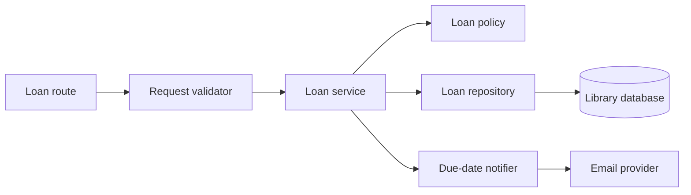

# Example: Harborlight component architecture

> Fictional example for illustration. This architecture is not derived from an actual repository.

## What this diagram explains

This view zooms into the fictional Harborlight web application to show which internal components handle a new loan.

## Architecture diagram

## How it works

The route receives the request. Validation checks required fields. The loan service coordinates the policy check and record creation. The repository handles database access. After a successful loan, the service asks a notifier to send a due-date message.

## Main components

- **Loan route** — accepts a web request. Example source: `src/web/routes.py` (`create_loan`).
- **Request validator** — checks the incoming reader and book identifiers. Example source: `src/web/validation.py` (`validate_loan_request`).
- **Loan service** — coordinates the use case. Example source: `src/loans/service.py` (`LoanService.create`).
- **Loan policy** — decides whether the reader may borrow the book. Example source: `src/loans/policy.py` (`can_borrow`).
- **Loan repository** — stores and retrieves loan records. Example source: `src/loans/repository.py` (`LoanRepository`).
- **Due-date notifier** — requests email delivery. Example source: `src/notifications/email.py` (`DueDateNotifier`).

## Assumptions and uncertainties

The diagram depicts a synchronous request path for illustration. A real repository must be checked for transaction boundaries and asynchronous queues before confirming this order. Example paths are fictional.

## Verification and limitations

Illustrative only; no repository was analyzed. The diagram intentionally omits framework and deployment details.
