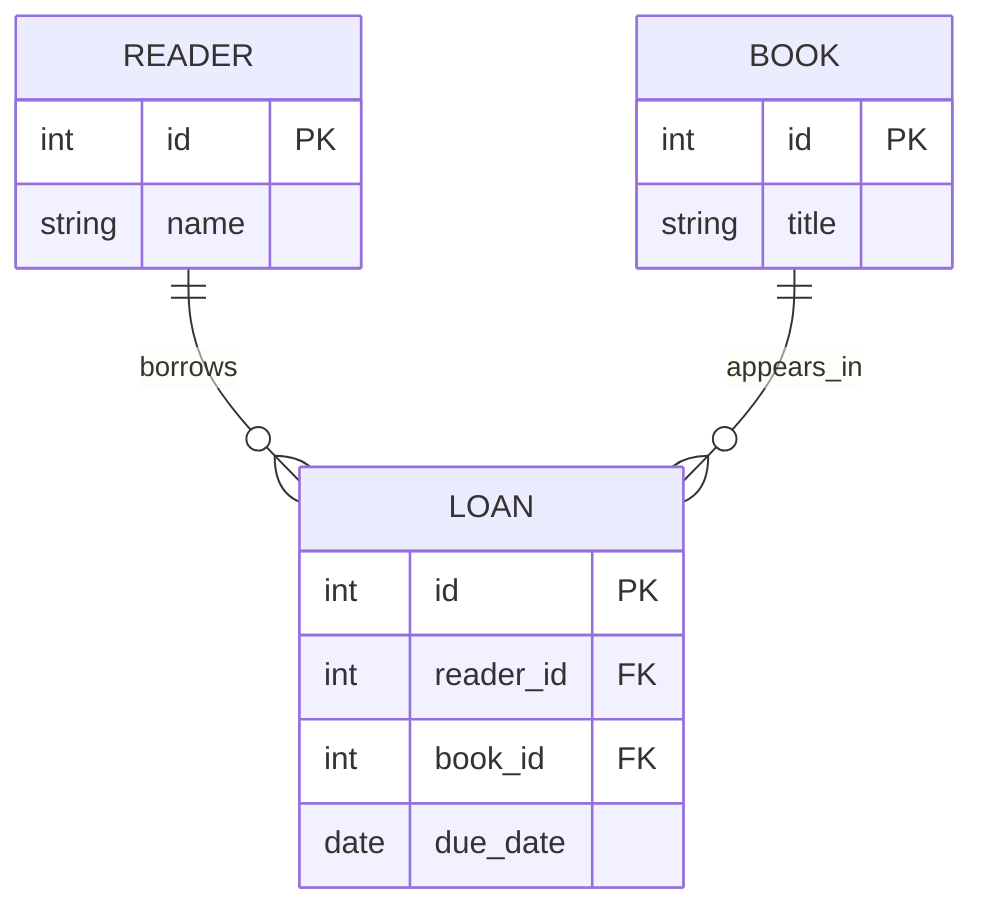

# Example: Harborlight data model

> Fictional example for illustration. This model is not derived from an actual repository.

## What this diagram explains

This ER diagram shows readers, books, and the loans that connect a reader to a book.

## Architecture diagram

## How it works

One reader may have multiple loan records over time. One book may also appear in multiple loan records over time. Each loan points to one reader and one book. This example assumes the foreign keys are explicitly declared.

## Main components

- **READER** — a person registered with the library. Example source: `src/db/models.py` (`Reader`).
- **BOOK** — a catalog item. Example source: `src/db/models.py` (`Book`).
- **LOAN** — a record connecting one reader to one book and storing a due date. Example source: `src/db/models.py` (`Loan`).

## Assumptions and uncertainties

The cardinalities and foreign-key meanings are confirmed only within this fictional model. A real diagram must derive them from schema declarations, migrations, or explicit ORM relationships. Similar field names by themselves are insufficient.

## Verification and limitations

Illustrative only; no database was inspected. The diagram omits indexes, status fields, and history details to keep the example readable.
