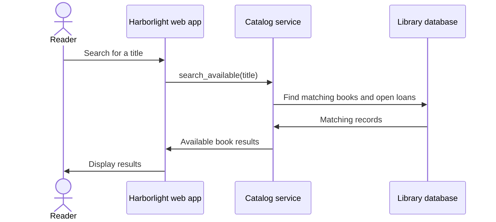

# Example: search for an available book

> Fictional example for illustration. This interaction is not derived from an actual repository.

## What this diagram explains

This sequence shows the request order when a reader searches for available copies.

## Architecture diagram

## How it works

The reader submits a title. The web app passes it to the catalog service. The catalog service reads book and loan information, then returns the available matches for display.

## Main components

- **Reader** — starts the search.
- **Web app** — accepts and displays the search. Example source: `src/web/routes.py` (`search_books`).
- **Catalog service** — applies search and availability rules. Example source: `src/catalog/service.py` (`CatalogService.search_available`).
- **Database** — provides book and loan records. Example source: `src/db/models.py` (`Book`, `Loan`).

## Assumptions and uncertainties

The arrows illustrate ordered request/response messages, not observed production traffic. The example does not claim whether a cache or search index is used. Example source paths are fictional.

## Verification and limitations

Illustrative only; no repository was analyzed. A real sequence must follow verified call order and should mark queued/asynchronous interactions only when implementation evidence confirms them.
