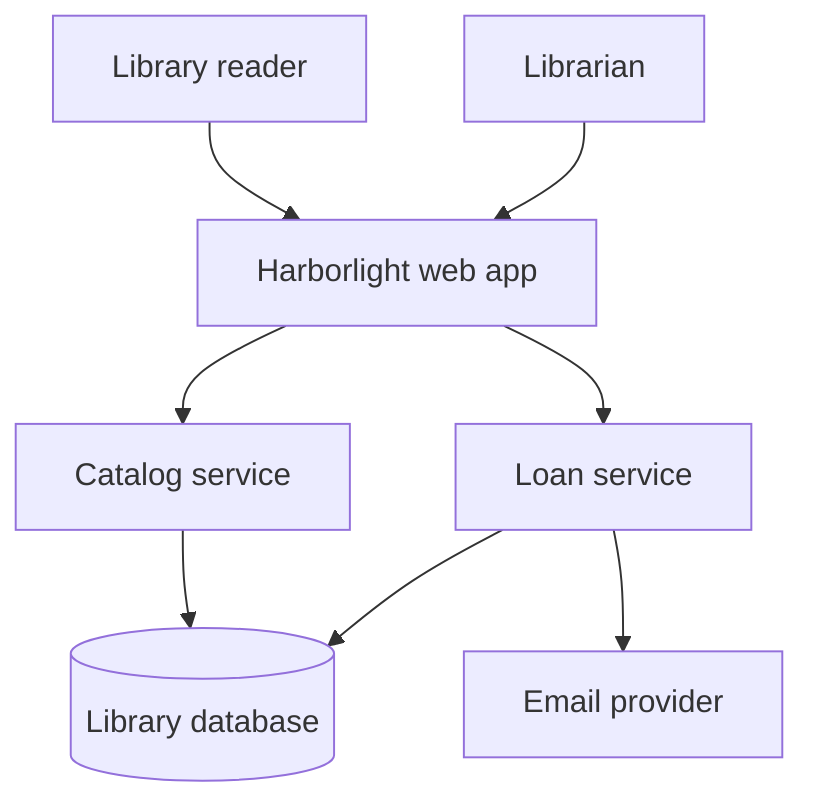

# Example: Harborlight system overview

> Fictional example for illustration. This architecture is not derived from an actual repository.

## What this diagram explains

Harborlight is a small community library app. This view shows who uses it, the application boundary, the main responsibilities inside it, and where book and loan records are stored.

## Architecture diagram

## How it works

1. A reader searches or requests a book through the web app.
2. The app asks the catalog service for book information or the loan service to create a loan.
3. The services read or update records in the library database.
4. The loan service asks the email provider to send a due-date notice.

## Main components

- **Web app** — the screen and request entry point used by readers and librarians. Example source: `src/web/routes.py` (`search_books`, `create_loan`).
- **Catalog service** — finds and returns book records. Example source: `src/catalog/service.py` (`CatalogService`).
- **Loan service** — records a loan and requests a reminder. Example source: `src/loans/service.py` (`LoanService.create`).
- **Library database** — stores books, readers, and loans. Example source: `src/db/models.py` (`Book`, `Reader`, `Loan`).
- **Email provider** — delivers notices outside the app. Example source: `src/notifications/email.py` (`EmailSender.send`).

## Assumptions and uncertainties

Every edge is confirmed within this fictional example. A real analysis would inspect the routes, service calls, database declarations, and email client before drawing these connections. The diagram does not claim a particular hosting or deployment arrangement.

## Verification and limitations

Illustrative only; no repository was analyzed. The source paths and symbols above are examples, not links to real files.
