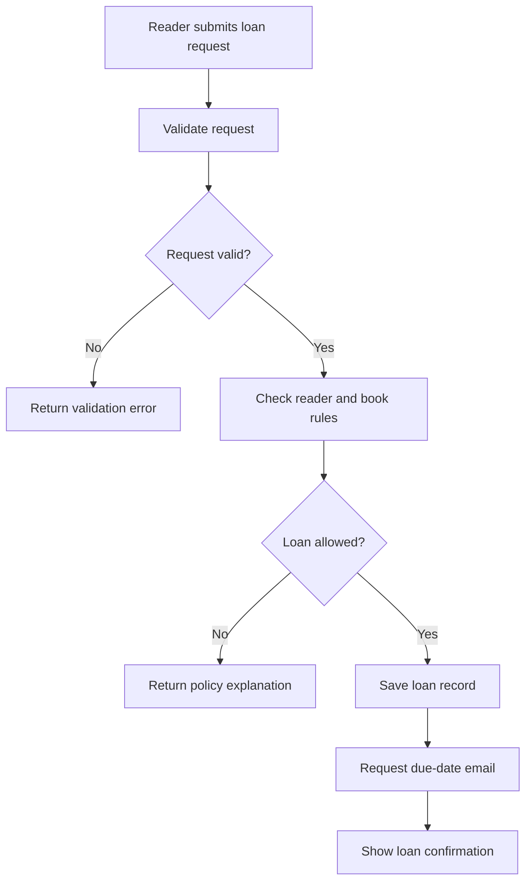

# Example: creating a library loan

> Fictional example for illustration. This workflow is not derived from an actual repository.

## What this diagram explains

This flow shows the decisions made when a reader requests a book and when an email notice is sent.

## Architecture diagram

## How it works

1. The request is checked for required information.
2. If it is incomplete, the app returns an error without creating a loan.
3. Otherwise, the policy checks whether the reader and book qualify.
4. If the policy rejects it, the app explains why.
5. If accepted, the app saves the loan, requests a due-date email, and confirms the loan.

## Main components

- **Request handler** — receives the request and returns a response. Example source: `src/web/routes.py` (`create_loan`).
- **Loan policy** — checks eligibility. Example source: `src/loans/policy.py` (`can_borrow`).
- **Loan repository** — saves the accepted loan. Example source: `src/loans/repository.py` (`LoanRepository.create`).
- **Email notifier** — requests the due-date message. Example source: `src/notifications/email.py` (`DueDateNotifier.send`).

## Assumptions and uncertainties

The illustrated path shows the intended order, but it does not establish whether email delivery is synchronous or queued, or what happens if delivery fails. Those details are UNKNOWN here and omitted from the flow.

## Verification and limitations

Illustrative only; the fictional source references do not exist in this repository.
